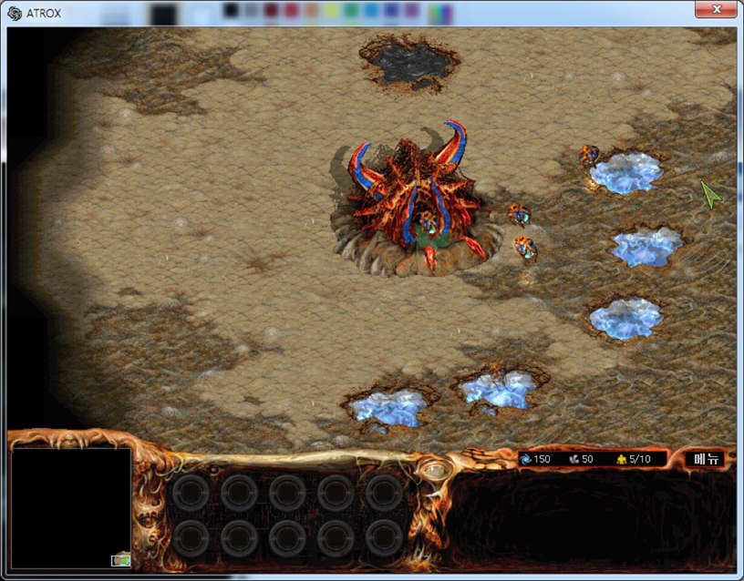

# 아트록스 창모드

아트록스(조이맥스)를 800x600 창으로 실행되게 하는 실행파일 바이트 패치다. 전체 화면으로 바꾸는 블록을 건너뛰고, 해상도를 800x600 으로 고정하고, 창 안에서 다루기 알맞게 스크롤 이동량을 8분의 1로 줄였다. 바꾼 바이트와 어셈블리 해석은 [docs/window-mode.ko.md](docs/window-mode.ko.md) 에 있다.

**호환 버전**: 아트록스 v1.10 빌드 1 (UPX 를 푼 `atrox.exe`, md5 `b4c64c06c2afd830995ef497478718be`)

<p>
  
</p>


## 사용 방법

패치는 문서의 표를 보고 직접 적용한다.

1. 정품 `atrox.exe` 는 UPX 로 압축되어 있으므로 `upx -d` 로 먼저 푼다.
2. 헥스 에디터로 [docs/window-mode.ko.md](docs/window-mode.ko.md) 표의 파일 오프셋마다 원래 바이트를 확인하고 바꾼 바이트로 덮어쓴다.
3. 고친 실행파일을 아트록스 폴더에서 실행하면 800x600 창으로 뜬다.

게임 옵션의 마우스 스크롤과 키보드 스크롤은 세 번째 칸에 맞춰 둬야 화면이 알맞게 움직인다. 창 가장자리 스크롤을 쓰려면 WindowMouseCapturer 같은 마우스 가두기 프로그램으로 마우스를 창 안에 가두면 된다.


## 구현 원리

**전체 화면 블록을 건너뛴다.** `GetWindowLongA` / `SetWindowLongA` 로 창 스타일에서 제목표시줄을 떼어 내는 전체 화면용 블록이 있고, 그 앞의 조건 점프가 이 블록에 들어갈지를 정한다. 이 `JE` 를 같은 목적지의 `JMP` 로 바꿔 늘 건너뛰게 했다.

**해상도 모드를 1 로 고정한다.** 해상도 설정 함수는 모드 0 이면 640x480, 1 이면 800x600 을 쓴다. 옵션에 저장된 모드를 꺼내 넘기는 자리를 빈 공간의 짧은 코드로 돌려, 늘 1 을 넘기게 했다. 시작할 때 화면이 가운데 놓이도록 초기화 함수가 쓰는 값 하나도 1 에서 0 으로 바꿨다.

**스크롤 값을 8 로 나눈다.** 이동량을 스크롤 함수 두 개에 넘기는 자리에 `sar` 를 끼울 공간이 없어서, 두 호출을 함수 사이의 빈자리로 옮기고 그 앞에 `sar esi, 3` 과 `sar ebx, 3` 을 넣은 다음 원래 흐름으로 돌아오게 했다.

```
0042D477  EB 3C              jmp  0x0042D4B5
...
0042D4B5  C1 FE 03           sar  esi, 3
0042D4B8  56                 push esi
0042D4B9  E8 BC 9D FD FF     call 0x0040727A
0042D4BE  EB BD              jmp  0x0042D47D
```


## 파일

| 경로 | 내용 |
|---|---|
| `docs/window-mode.ko.md` | 대상 파일, 바꾼 바이트 표, 어셈블리 해석 |
| `docs/screenshots/` | 스크린샷 |


## 라이선스

zlib 라이선스다. 자세한 내용은 [LICENSE](LICENSE) 에 있다.
